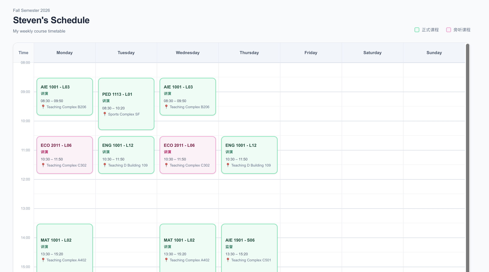
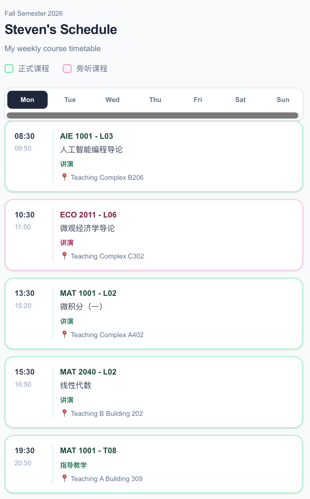

# Course Timetable — Fall 2026

A personal, responsive course timetable maintained by Steven Pan. It brings weekly scheduling, course descriptions, instructor links, and location photos into one place.

[Live timetable](https://steven-s-weekly-course-timetable-fa.vercel.app) · [中文说明](README.zh-CN.md) · [Data guide](docs/data-guide.md)

## Preview

### Desktop weekly view



### Mobile daily view



## Features

- Desktop weekly grid with time-based course positioning.
- Mobile daily view with weekday selection and an empty-day message.
- Separate visual styles for enrolled and audited courses.
- Course details with instructor links and location photos.
- Keyboard-accessible course buttons and a native modal dialog.

## Project context

This is a personal academic planning and frontend practice project, not an official university timetable or a research result. Course enrollment and auditing are distinguished in the data. The application does not fetch live enrollment information.

The implementation uses Next.js 16, React 19, TypeScript, and Tailwind CSS 4. Static export keeps deployment simple: course information is bundled at build time, while day selection and course details run in the browser.

## Run locally

Use Node.js 22.18 or newer (CI uses Node.js 24) and npm. No environment variables are required.

```sh
npm ci
npm run dev
```

Open http://localhost:3000.

```sh
npm run lint
npm run typecheck
npm test
npm run build
```

The build generates `out/`. To preview it, with Python 3 installed:

```sh
npm start
```

This serves static files on localhost:3000. Run the build again after changing source files. Deploy `out/` to a static host; this project does not use a production Next.js server.

## Repository structure

```text
app/                         Route entry, metadata, and global styles
components/timetable/        Interactive timetable and course dialog
data/fall-2026.ts             Semester course sessions and descriptions
lib/timetable.ts             Time conversion and positioning
public/images/locations/     Shared location photos
tests/                       Time and semester-data checks
docs/data-guide.md           Editing and verification instructions
.github/workflows/           Automated checks
```

`node_modules/`, `.next/`, and `out/` are generated locally and are not source files. `AGENTS.md` and `CLAUDE.md` contain development-tool guidance.

## Maintenance and limitations

Edit `data/fall-2026.ts` to update courses; see the [data guide](docs/data-guide.md). This is a recurring weekly view for Fall 2026, using campus local time (Asia/Shanghai). It does not model holidays, date-specific changes, overlapping-course layout, calendar export, or user accounts. The initial mobile selection is Monday.

Course descriptions and instructor links are retained from the existing dataset. Their original sources and photo ownership still need to be documented by the maintainer. Verify current arrangements with official university information. This repository does not currently grant a separate open-source license; third-party text and images should not be assumed to be freely reusable.

## Maintainer

[zhenjiapan](https://github.com/zhenjiapan)
