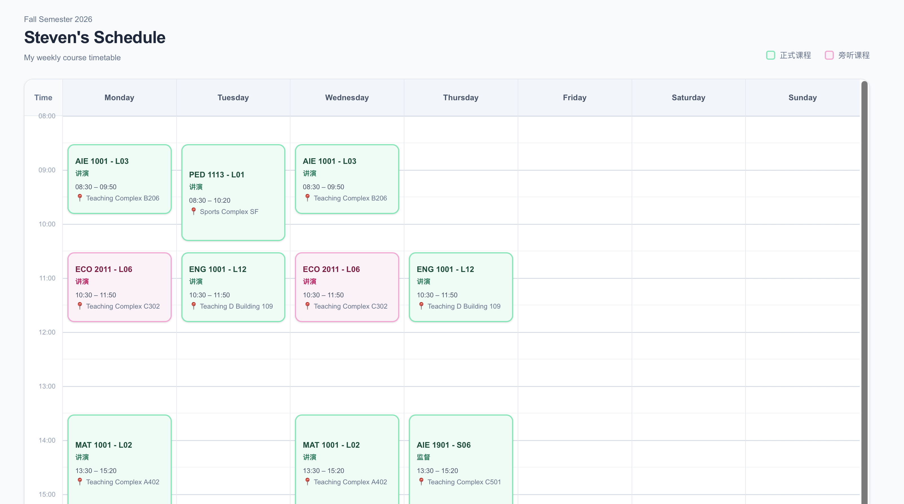
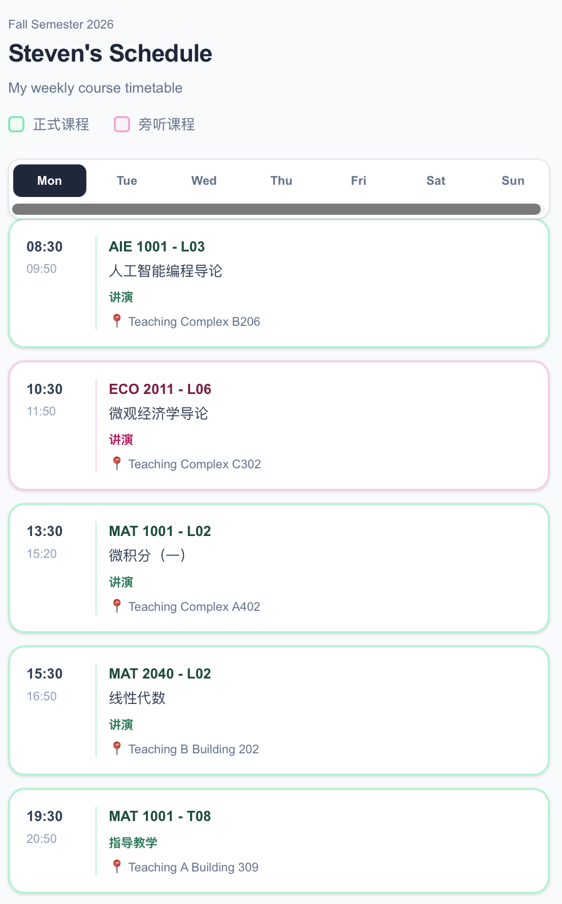

# 课程表 — 2026 年秋季学期

Steven Pan 维护的个人课程表，集中展示每周安排、课程简介、教师主页和地点照片。

[在线课表](https://steven-s-weekly-course-timetable-fa.vercel.app) · [English](README.md) · [数据维护指南](docs/data-guide.md)

## 界面预览

### 桌面端周课表



### 移动端日课表



## 功能与项目定位

- 桌面端按时间排列的周课表，移动端按天查看，无课日期显示提示。
- 区分正式课程与旁听课程。
- 课程详情包含简介、教师链接和地点照片。
- 课程按钮支持键盘操作，详情采用原生对话框。

这是个人学习安排与前端实践项目，并非学校官方课表或科研成果。课程信息随构建发布，不会实时同步学校系统。

技术栈为 Next.js 16、React 19、TypeScript 和 Tailwind CSS 4。项目采用静态导出，浏览器负责日期切换和详情交互。

## 本地使用

使用 Node.js 22.18 或以上版本和 npm；自动检查使用 Node.js 24。不需要环境变量。

```sh
npm ci
npm run dev
```

打开 http://localhost:3000。检查与构建：

```sh
npm run lint
npm run typecheck
npm test
npm run build
```

构建产物位于 `out/`。安装 Python 3 后运行 `npm start`，可在本机 3000 端口预览静态网站。修改源码后需要重新构建。部署时发布 `out/`，无需启动 Next.js 生产服务器。

## 文件与维护

- `app/`：页面入口、网站信息和全局样式。
- `components/timetable/`：课表交互及课程详情弹窗。
- `data/fall-2026.ts`：课程安排与简介。
- `lib/timetable.ts`：时间转换与定位计算。
- `public/images/locations/`：共享地点照片。
- `tests/`：时间计算、课程数据和图片路径检查。
- `.github/workflows/`：自动检查。

`node_modules/`、`.next/`、`out/` 是本地生成内容，不是需要手动维护的源码。`AGENTS.md`、`CLAUDE.md` 是开发工具说明。

## 适用范围与资料来源

适用于 2026 秋季学期的重复周安排，时间采用校园当地时间 Asia/Shanghai。暂不处理节假日、临时调课、重叠课程布局、日历导出或用户账户；移动端初始显示星期一。

现有课程简介、教师链接及照片被保留。原始资料出处和照片权属仍需维护者补充，实际安排请以学校官方信息为准。仓库目前未单独授予开源许可证，第三方文字和图片不可默认自由复用。

维护者：[Steven Pan / zhenjiapan](https://github.com/zhenjiapan)
